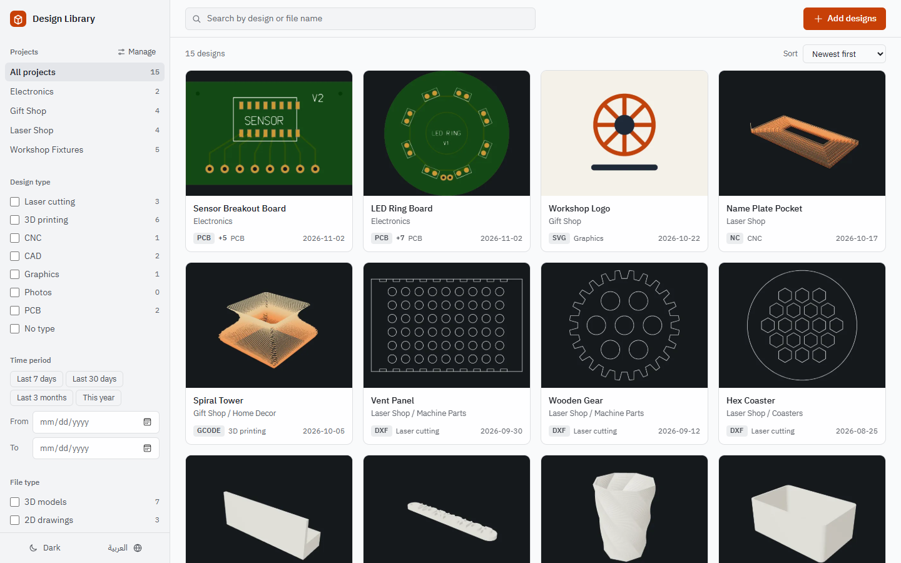
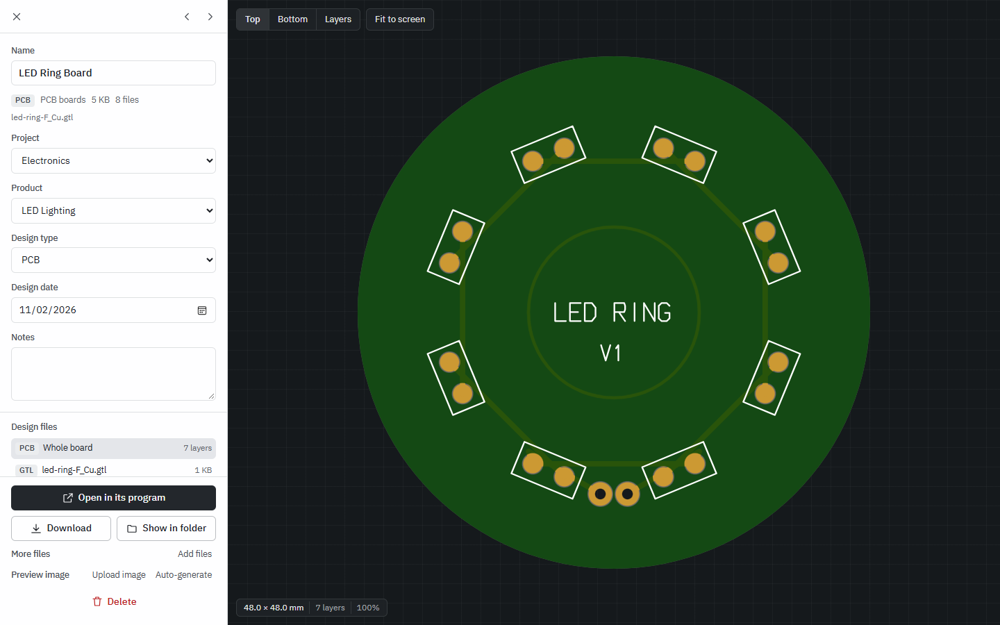
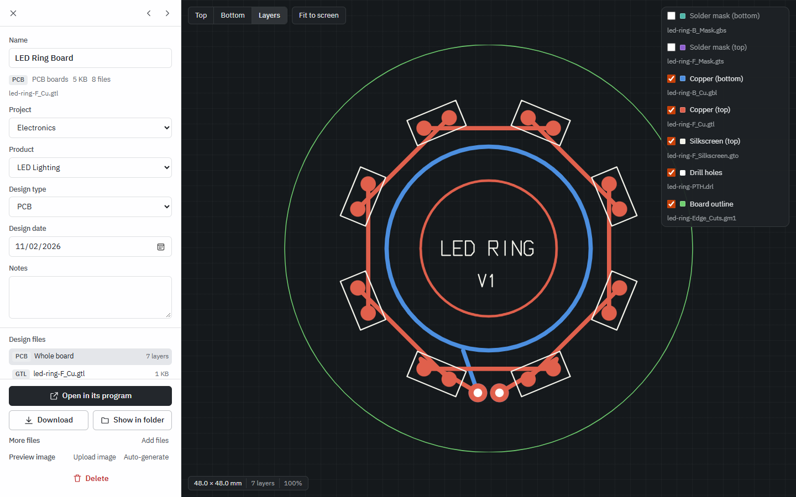
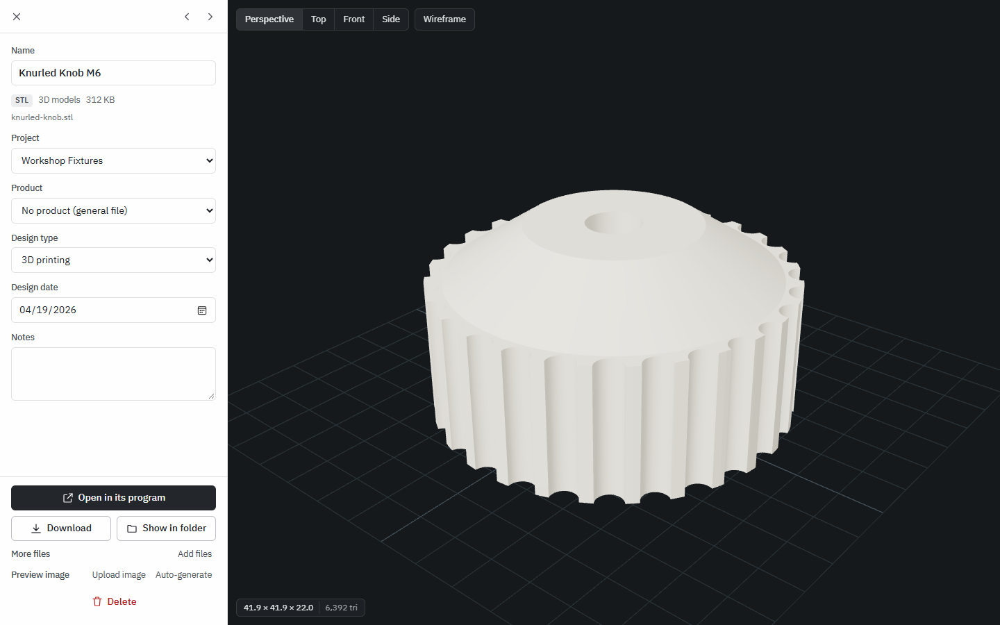
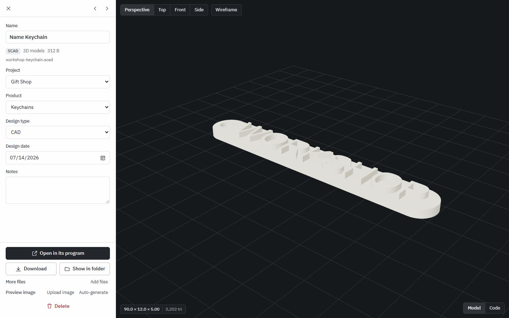
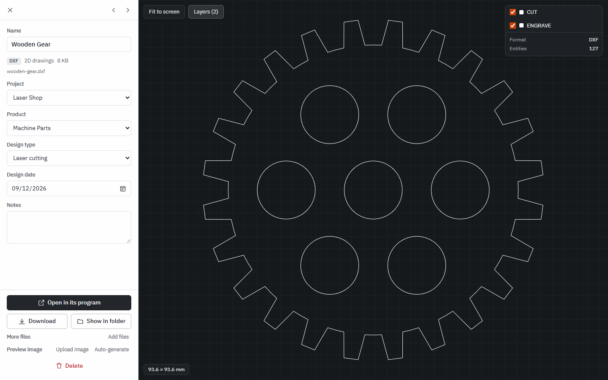
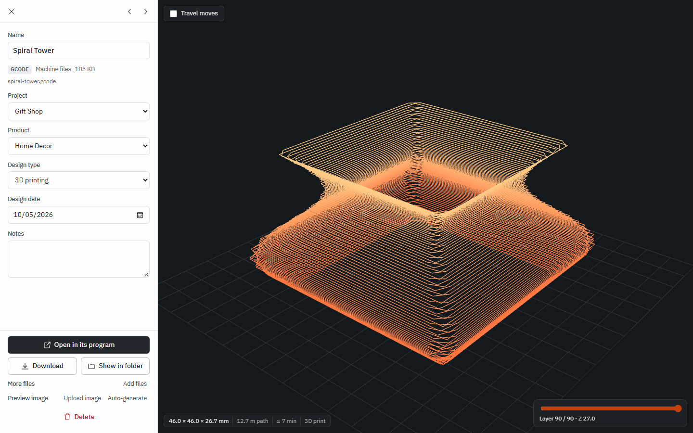
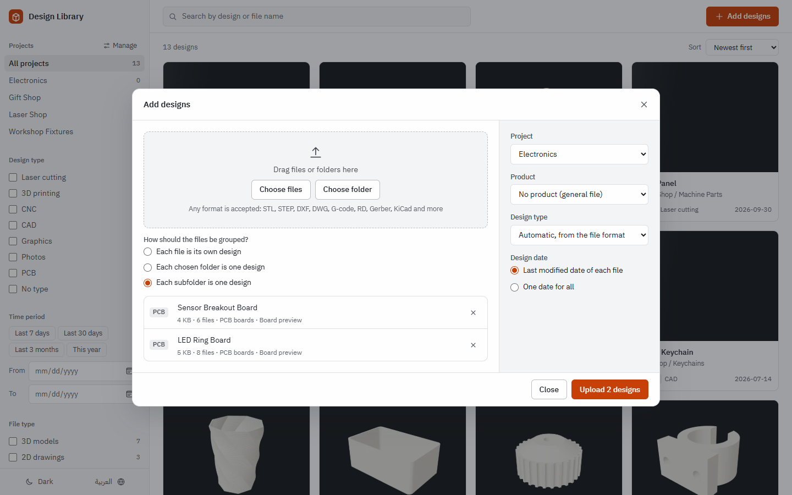
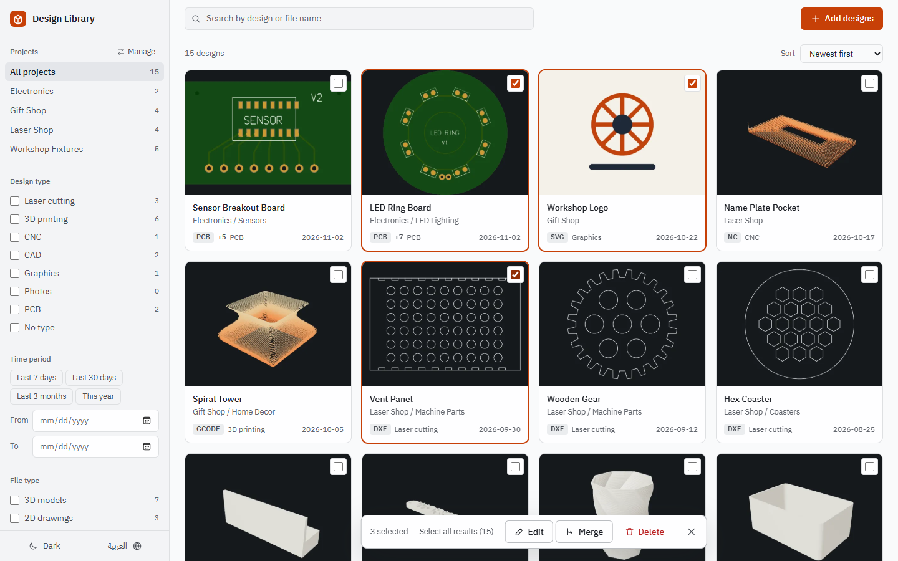
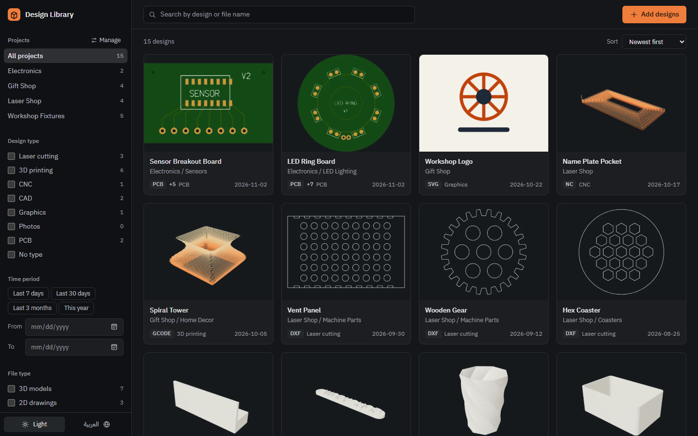

# Design Library: STL, CAD, Laser and PCB File Manager for Windows

**Design Library is a free, open-source desktop app that organizes design files by project and product, and previews them without opening their own programs.** It handles STL, 3MF, STEP, DXF, DWG, G-code, RDWorks RD, Gerber, KiCad and OpenSCAD files in one searchable library. Everything stays on your computer: no account, no cloud and no telemetry.

It is built for makers and small workshops that do 3D printing, laser cutting, CNC and electronics, and whose files are scattered across folders. The interface is available in English and Arabic.

[](https://github.com/samehmesrega/stl-cad-pcb-file-manager/releases/latest)
[](LICENSE)



## Contents

- [Features](#features)
- [Supported file formats](#supported-file-formats)
- [Installation](#installation)
- [Screenshots](#screenshots)
- [Quick start](#quick-start)
- [FAQ](#faq)
- [Your data and backups](#your-data-and-backups)
- [Build from source](#build-from-source)
- [License](#license)

## Features

- **Organize by project and product.** Filter by project, product, design type, file type and date range, and search by name across every file.
- **Built-in viewers.** Rotate 3D models, read a drawing's size and coordinates, step through G-code layers, and inspect PCB layers.
- **Automatic thumbnails.** Files with a visual preview get a picture in the library grid, generated on your own machine.
- **PCB boards.** See the finished board from both sides from its Gerber and drill files, turn each layer on and off, and open KiCad boards and schematics.
- **OpenSCAD models.** `.scad` files are computed and shown as 3D models or 2D drawings, next to their code.
- **Designs made of many files.** A board folder or a ZIP of Gerbers becomes one design. A folder holding several boards becomes several designs. Merge existing designs or split a file back out.
- **Open in its own program.** One click opens the file in KiCad, RDWorks, your slicer or whatever Windows has registered for it. Program files such as `.exe` are never run from the library.
- **Bulk editing.** Select designs, or all search results, then change their project, product, type or date, or delete them together.
- **Duplicate detection.** Files are compared by content (SHA-256), so a copy is found even under a different name. The duplicate tool always leaves at least one copy of a file.
- **English and Arabic.** Switch the language from the bottom of the sidebar. Arabic uses a full right-to-left layout.
- **Light and dark themes.**

## Supported file formats

| Category | Formats with a built-in preview |
| --- | --- |
| 3D models | STL, 3MF, AMF, STEP/STP, IGES/IGS, BREP, OBJ, PLY, GLB/GLTF, FBX, 3DS, WRL, DAE |
| Parametric CAD | OpenSCAD (SCAD) |
| 2D drawings | DWG, DXF, PLT/HPGL, AI (PDF-compatible), CDR (embedded thumbnail only) |
| Machine files | RDWorks RD, G-code (GCODE, GCO, G), NC, NGC, TAP, CNC |
| PCB design | Gerber (GBR, GER, GTL, GBL, GTS, GBS, GTO, GBO, GTP, GBP, GKO, GM1 and others), Excellon drill (DRL, XLN), KiCad board and schematic (KICAD_PCB, KICAD_SCH) |
| Images and documents | PNG, JPG, WEBP, GIF, BMP, SVG, AVIF, TIFF, PSD, PDF, TXT, CSV, JSON, XML, MD |

Any other file type can still be stored, filtered and opened in its own program, with a preview picture you upload yourself. That includes SolidWorks, Fusion 360, Rhino, Blender, LightBurn, Altium, Eagle and EasyEDA files.

## Installation

### Windows installer (recommended)

Requires Windows 10 or 11, 64-bit. Tested on Windows 11.

The installer is a file attached to the [Releases page](https://github.com/samehmesrega/stl-cad-pcb-file-manager/releases/latest), about 125 MB. You will not find it in the list of code files above.

1. Download **[Design.Library.Setup.1.2.0.exe](https://github.com/samehmesrega/stl-cad-pcb-file-manager/releases/latest/download/Design.Library.Setup.1.2.0.exe)**.
2. Run it. If Windows SmartScreen shows a warning, click **More info**, then **Run anyway**. The warning appears because the installer is not code-signed.
3. Choose **Only for me** and click **Next**. This option does not need administrator rights.
4. Keep the suggested folder, or pick another one, and click **Install**.
5. Click **Finish** to open the app. Later, open **Design Library** from the desktop or the Start menu.
6. Optional: right-click its taskbar icon and choose **Pin to taskbar**.

The app starts in your system's language if that is Arabic, and in English otherwise. The language button at the bottom of the sidebar switches it, and your choice is remembered.

To update, run the newer installer. To uninstall, open **Settings > Apps** in Windows and remove **Design Library**. Neither one touches your library.

### Run from source

Requires [Node.js](https://nodejs.org) 22.18 or newer. Tested on Windows 11.

```bash
git clone https://github.com/samehmesrega/stl-cad-pcb-file-manager.git
cd stl-cad-pcb-file-manager
npm install
npm run build
npm start
```

Then open <http://localhost:4600>. On Windows, double-clicking `start.bat` runs these steps as needed and opens the app in its own Microsoft Edge window, or in your default browser.

## Screenshots

### PCB viewer for Gerber files

The finished board from both sides, built from its Gerber and drill files.



### PCB layers

Turn copper, solder mask, silkscreen, solder paste, drill and outline layers on and off.



### 3D viewer for STL, 3MF and STEP



### OpenSCAD models



### DXF and DWG viewer for laser and CNC



### G-code toolpath viewer



### Upload a folder of boards

A folder holding two boards is recognized as two designs.



### Bulk editing



### Dark theme



All screenshots use made-up sample designs.

## Quick start

1. Click **Add designs**, or drag files and folders onto the window.
2. Pick a project and a product, or create them on the spot.
3. Click **Upload**. The design type and the date come from each file automatically, and you can change them.
4. Click any card to open its viewer.

To select several designs, tick the box on a card, or hold Ctrl or Shift while clicking.

## FAQ

### What is the best way to organize STL files on Windows?

Keep them in a library that indexes them by project and shows a thumbnail of each model, instead of relying on folder names. Design Library does this locally for STL, 3MF and STEP files, along with the laser, CNC and PCB files that belong to the same product.

### Can I preview DXF, DWG, G-code or Gerber files without installing CAD software?

Yes. Design Library has built-in viewers for DXF, DWG, G-code, RDWorks RD, Gerber and KiCad files, so you do not need AutoCAD, RDWorks or KiCad just to look at a file.

### Does it work offline?

Yes. The library, the thumbnails and the viewers all run on your computer. One exception: the KiCad viewer loads its button icons from Google Fonts, and without internet one button shows a word instead of an icon but still works.

### Are my design files uploaded anywhere?

No. "Upload" here means copying files into the library folder on your own computer. The app has no account and no telemetry, and your original files stay where they are.

### How do I add a PCB project with Gerber and KiCad files?

Choose the board's folder, or a ZIP of its Gerbers, in the **Add designs** dialog. The files become one design, and they keep their folder layout on disk so KiCad can still find them. Backups and cache files that KiCad generates are left out.

### Can it detect duplicate files?

Yes. Every file gets a SHA-256 fingerprint, so identical files are matched whatever their names are. You choose which copy to keep.

### Why does an OpenSCAD file show its code instead of a model?

The file has no model of its own, as with a library of functions, or it needs a file that is not in the library. Text drawn with a font other than the bundled Liberation Sans may look different from the original. Very heavy models can reach the time limit.

### How is it different from Manyfold?

[Manyfold](https://github.com/manyfold3d/manyfold) is an open-source, self-hosted web application for 3D models, focused on 3D printing and distributed as a Docker image. Design Library is an installable Windows desktop app that also covers 2D, laser, CNC and PCB files in the same library.

### Can a team use it?

Each computer has its own library by default, and there is no login. When running from source, set `HOST=0.0.0.0` before starting to open it on your local network, on port 4600. Anyone on that network can then edit and delete designs, so use it only on a network you trust.

## Your data and backups

Everything lives in `Documents\Design Library`: the database `library.db`, your files in `files\`, and the thumbnails in `thumbs\`. The folder is outside the program, so reinstalling or uninstalling does not delete it.

To back up, copy that folder while the app is closed. To use another location when running from source, set the `DATA_DIR` environment variable.

**Open in its program** opens the library's copy of the file, so saving in that program changes it. The thumbnail does not refresh by itself after an edit, and the **Auto-generate** link in the design's side panel makes a new one.

## Build from source

```bash
npm run dev    # server and Vite with hot reload
npm test       # file parser, server and translation tests
npm run build  # type check and build the interface into dist/
npm run app    # build and run as a desktop app
npm run dist   # build the Windows installer into release/
```

| Path | Contents |
| --- | --- |
| `shared/formats.ts` | Every format, its category and its viewer. Adding a format starts here. |
| `shared/i18n.ts` | The Arabic translation of every English string in the app |
| `server/` | Express API and SQLite database |
| `electron/main.ts` | Entry point of the installed app |
| `src/loaders/` | File parsers |
| `src/viewers/` | Viewers |
| `src/thumbs.ts` | Thumbnails, rendered in the browser |

Built with Electron, React, three.js, SQLite, OpenCascade (occt-import-js), LibreDWG, tracespace, KiCanvas, OpenSCAD and pdf.js.

`public/vendor/kicanvas/kicanvas.js` is a prebuilt copy of [KiCanvas](https://github.com/theacodes/kicanvas), which is not on npm and is still in alpha. To update it, replace the file with `https://kicanvas.org/kicanvas/kicanvas.js`.

## License

Design Library is licensed under the [GNU General Public License v3.0 or later](LICENSE).

The installer bundles third-party components under their own licenses, including `@mlightcad/libredwg-web` and `@mlightcad/dxf-json` (GPL-3.0), `openscad-wasm-prebuilt` (GPL-2.0-or-later), KiCanvas and tracespace (MIT), and the Liberation fonts (SIL Open Font License).
